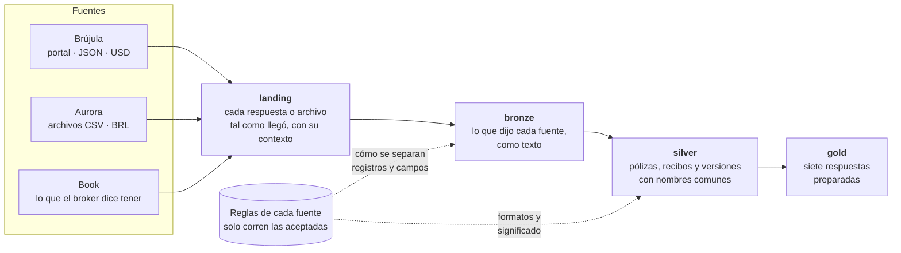

# Base compartida de aseguradoras

Un broker de seguros necesita saber qué pólizas y cobros le muestra cada aseguradora y contrastarlo con lo que él dice tener. Conectarse a cada aseguradora no alcanza: los registros cambian, los números se repiten entre fuentes, faltan valores y lo que se aprende de cada una se pierde en la siguiente integración.

Este repo reúne en una base de datos local las pólizas y los recibos de dos aseguradoras de ejemplo, Brújula (un portal web, en USD) y Aurora (archivos CSV, en BRL), sin perder lo que dijo cada una ni de dónde salió. Es una prueba de concepto: dos fuentes y pocos datos, todos ficticios.

## Cómo fluye un dato



Landing es lo único que no se puede volver a obtener, porque la fuente ya cambió. Todo lo demás se borra y se rehace desde ahí con un comando.

El mismo recorrido con un caso: el recibo `R-103` llega del portal con el monto `TBD`.

| Capa | Qué queda del monto |
|---|---|
| landing | La respuesta del portal, sin cambios |
| bronze | El texto `TBD` |
| silver | Texto `TBD`, valor vacío y el veredicto *no utilizable*, por la regla CONTRACT-17 |
| gold | Fuera del total, y contado: "130.00 USD abiertos, más 1 recibo abierto sin monto utilizable" |

## Cómo probarlo

Hace falta Python 3.11 o posterior. No se instala nada más para correrlo.

```bash
make construir     # captura las dos aseguradoras y el book, y arma la base en datos/
make respuestas    # muestra las siete respuestas preparadas
make verificar     # estilo y pruebas; este necesita uv (https://docs.astral.sh/uv/)
```

Si tienes `uv`, él consigue el Python correcto. Si no, se usa `python3`; cuando ese sea más viejo, indica otro: `make construir PY=python3.12`.

`make construir` arranca el portal de Brújula en tu máquina dos veces, con los datos iniciales y con una corrección, y lee las dos entregas de Aurora. El **book** es el inventario de pólizas que cada broker dice tener.

## Cómo revisarlo en diez minutos

1. **Constrúyelo y compara.** `make construir` y `make respuestas`. La salida debe coincidir con [docs/evidencia/respuestas.txt](docs/evidencia/respuestas.txt).
2. **Sigue un número hasta su origen.** El recibo `R-102` cambió de 25.00 a 30.00. Cada versión dice de qué respuesta y de qué página salió:
   ```bash
   sqlite3 -header -column datos/base.sqlite "SELECT revision, monto, vigente, origen FROM gold_historial_recibos WHERE aseguradora = 'brujula' AND numero_recibo = 'R-102'"
   ```
3. **Rompe la fuente.** `make escenario E=failure` arranca el portal con una página que falla, y `make escenario E=drift` con una que cambia de forma. Los dos deben decir "4 declarados, 2 capturados", por qué, y que el total no está completo. Usan su propia carpeta: no tocan la base principal.
4. **Acepta la propuesta dudosa.** En `config/reglas.toml`, cambia el estado de `AGENT-22` de `propuesta` a `aceptada` y corre `make rehacer` y `make respuestas`. El monto de `R-103` no se vuelve cero: ahora dos reglas aceptadas dicen cosas distintas sobre `TBD`, ninguna decide y el valor queda *inválido*. `make verificar` falla y nombra las dos. Deshazlo con `git checkout config/reglas.toml` y `make rehacer`.
5. **Borra todo lo derivado.** `rm datos/base.sqlite`, luego `make rehacer` y `make respuestas`. Salen las mismas respuestas, sin volver a contactar el portal.
6. **Corre las pruebas.** `make verificar`. Los nombres de las pruebas dicen qué comprueban; la lista está en [docs/evidencia/verificar.txt](docs/evidencia/verificar.txt).
7. **Lee el código en el orden en que corre:** `captura.py` (guardar lo que llega), `bronze.py` (pasarlo a texto), `valores.py` (interpretar cada valor), `silver.py` (versiones y lo compartido), `gold.py` (las vistas). Son unas 1,500 líneas.

## Qué responde

| Pregunta | Vista |
|---|---|
| ¿Cuánto está abierto y qué quedó fuera de la suma? | `gold_abierto_conocido` |
| ¿Cuál es el historial de cada recibo? | `gold_historial_recibos` |
| ¿Qué pólizas están en el book, en la fuente o en los dos? | `gold_book` |
| ¿Qué reglas tiene cada fuente y en qué estado? | `gold_reglas` |
| ¿Qué valores no se pudieron usar, y por qué? | `gold_valores_no_validos` |
| ¿De qué campo de cada fuente sale cada nombre común? | `gold_diccionario` |
| ¿Quedó completa cada captura? | `gold_completitud` |

La salida completa está en [docs/evidencia/respuestas.txt](docs/evidencia/respuestas.txt), y la de las pruebas en [docs/evidencia/verificar.txt](docs/evidencia/verificar.txt). Para escribir tus propias consultas, la base es un archivo SQLite:

```bash
sqlite3 -header -column datos/base.sqlite "SELECT * FROM gold_abierto_conocido"
```

## Lo que este diseño resuelve

| Lo que pasa en el día a día | Qué hace este diseño | Dónde verlo |
|---|---|---|
| Una página del portal falla y el total sale más bajo, sin aviso | La falla se guarda como falla, no como página vacía. El total dice al lado si la última captura quedó completa: "2 de 4 recibos" | `gold_completitud`; prueba del escenario `failure` |
| La fuente cambia de forma sin avisar | No se adivina: la captura queda como "forma no reconocida", con su causa, y no da filas | Prueba del escenario `drift` |
| Alguien, o un asistente de IA, propone una regla que "hace que todo cuadre" | Queda registrada como propuesta y se puede consultar, pero solo corren las reglas aceptadas. La fecha de una regla nunca decide | `gold_reglas`; `test_14` |
| "¿De dónde salió este número?" | De un total se llega a la respuesta y la página, o al archivo y la línea, de donde salió cada versión | `gold_historial_recibos` |
| La aseguradora corrige un recibo | Es el mismo recibo con una versión más; la anterior se conserva. El orden en que se cargue no cambia el resultado | `test_08`, `test_09` |
| Lo que el broker dice tener no coincide con lo que muestra la fuente | Se reporta como "el book la afirma, la fuente no la muestra". Nunca como cancelada | `gold_book` |
| Cambia una regla, o se descubre que una estaba mal | Se rehace todo desde las capturas guardadas, sin volver a la fuente | `make rehacer`; `test_10` |
| Llega una aseguradora más | Se escribe su descriptor y sus reglas, y se registra su lector. Las vistas no cambian | `config/fuentes/` |

## Cómo está hecho

| Carpeta | Qué hay |
|---|---|
| `fuentes/` | El portal de Brújula, los archivos de Aurora, el book y las notas de cada fuente, sin modificar |
| `config/` | Lo que se sabe de cada fuente: la lista de reglas y un descriptor por fuente, que dice cómo leerla |
| `src/base_compartida/` | El código: captura, carga y vistas |
| `tests/` | Una prueba por comprobación del spec, y los casos que los datos de ejemplo no traen |
| `specs/0001-base-compartida/` | Qué debe cumplir (spec) y cómo se construyó (plan) |
| `docs/adr/` | Las cuatro decisiones de diseño, una página cada una |

Decisiones: [capas](docs/adr/0001-capas-de-la-base.md), [dónde vive lo que se sabe de cada fuente](docs/adr/0002-reglas-de-cada-fuente.md), [cómo se captura el portal](docs/adr/0003-captura-del-portal-de-brujula.md) y [herramientas](docs/adr/0004-herramientas.md).

## Límites, y qué cambia con volumen real

- No convierte monedas ni une registros de aseguradoras distintas: los datos no traen tipo de cambio ni una tabla que diga cuáles son el mismo. Todo total sale por aseguradora, broker y moneda.
- El historial tiene la resolución de las capturas: si la fuente cambia dos veces entre dos capturas, se ve solo el último valor.
- No reintenta una página que falla: la registra y marca la captura como incompleta.

| Hoy, en la prueba de concepto | Con volumen real |
|---|---|
| Capturas en una carpeta local | Almacenamiento de objetos, con reglas de retención |
| Un archivo SQLite | PostgreSQL, o tablas con historial propio |
| Lo compartido se recalcula completo en cada carga | Cargas que agregan solo lo nuevo, cuando el volumen lo pida |
| Reglas en archivos, con el estado escrito a mano | Flujo de aprobación con un dueño por fuente |
| Un comando que se corre a mano | Un orquestador con reintentos y alertas sobre la completitud |

Las capas, las reglas y las respuestas no cambian al dar ese paso; cambia dónde vive cada una.
